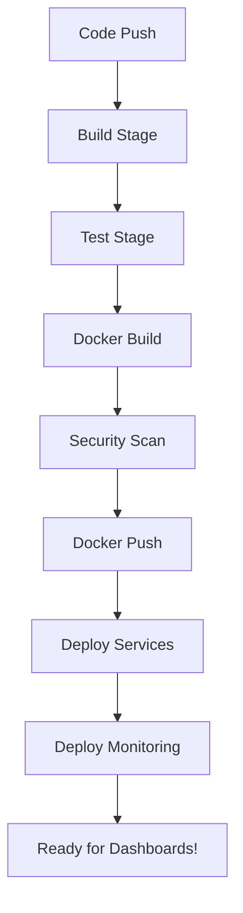

# GitLab CI/CD Monitoring Integration - COMPLETED ✅

## 🎯 Mission Accomplished!

We have successfully integrated Prometheus and Grafana monitoring into your GitLab CI/CD pipeline! Here's what has been implemented:

## 📋 What Was Added

### 1. **New CI/CD Job: `deploy-monitoring-k8s`**
- **Location**: Added to `.gitlab-ci.yml` in the `deploy` stage
- **Purpose**: Automated deployment of Prometheus and Grafana to Kubernetes
- **Dependencies**: Runs after main services are deployed successfully
- **Trigger**: Manual (safe deployment with `k8s-local` or `monitoring` branch)

### 2. **Pipeline Integration Features**
```yaml
deploy-monitoring-k8s:
  stage: deploy
  needs: [deploy-to-k8s-local]  # Ensures services are ready first
  when: manual                   # Safe manual trigger
  allow_failure: true           # Won't break pipeline
```

### 3. **Intelligent Deployment Process**
- ✅ **Service Readiness Check**: Waits for all main services to be ready
- ✅ **Sequential Deployment**: Prometheus first, then Grafana
- ✅ **Health Verification**: Checks pod readiness with timeouts
- ✅ **Status Reporting**: Shows URLs and target health
- ✅ **Error Handling**: Graceful failure with helpful messages

## 🚀 How to Use the New Pipeline

### Step-by-Step Deployment:
1. **Push to Branch**: `k8s-local` or `monitoring`
2. **Go to GitLab**: CI/CD → Pipelines
3. **Run Pipeline**: Click "Run Pipeline"
4. **Deploy Services**: Manually trigger `deploy-to-k8s-local`
5. **Deploy Monitoring**: Manually trigger `deploy-monitoring-k8s`
6. **Access Grafana**: `http://localhost:30300` (admin/admin123)

### Automatic Features:
- **Dependency Management**: Monitoring waits for services to be ready
- **Health Checks**: Verifies all Prometheus targets are UP
- **URL Display**: Shows access URLs for Prometheus and Grafana
- **Target Verification**: Checks monitoring stack health

## 📊 Pipeline Workflow



## 🔍 What Happens During Monitoring Deployment

### Phase 1: Pre-checks
- Verifies Kubernetes cluster connectivity
- Checks if main services are running

### Phase 2: Service Readiness
- Waits for discovery-service, gateway-service, user-service, ticket-service
- Timeout: 120 seconds per service

### Phase 3: Prometheus Deployment
```bash
kubectl apply -f kubernetes/prometheus-rbac.yaml
kubectl apply -f kubernetes/prometheus-configmap.yaml  
kubectl apply -f kubernetes/prometheus-deployment.yaml
```

### Phase 4: Grafana Deployment
```bash
kubectl apply -f kubernetes/grafana-configmap.yaml
kubectl apply -f kubernetes/grafana-deployment.yaml
```

### Phase 5: Verification & Reporting
- Checks pod readiness (180s timeout)
- Shows monitoring stack status
- Displays access URLs
- Verifies Prometheus targets health

## 📁 Files Created/Modified

### Modified:
- **`.gitlab-ci.yml`** - Added monitoring deployment job
- **`README.md`** - Updated with monitoring CI/CD information

### Created:
- **`MONITORING-CICD-GUIDE.md`** - Complete documentation

## 🎉 Expected Output

When the pipeline runs successfully, you'll see:

```bash
=== MONITORING STACK STATUS ===
NAME                     READY   STATUS    RESTARTS   AGE
grafana-xxx-xxx          1/1     Running   0          2m
prometheus-xxx-xxx       1/1     Running   0          3m

=== MONITORING ACCESS URLS ===
Prometheus: http://localhost:30090
Grafana: http://localhost:30300 (admin/admin123)

=== PROMETHEUS TARGETS CHECK ===
All 5 targets UP: prometheus, discovery-service, gateway-service, user-service, ticket-service

Monitoring stack deployment completed successfully!
Access Grafana at http://localhost:30300 to create dashboards
```

## 🎯 Key Benefits

### 1. **Automated Monitoring**
- No manual kubectl commands needed
- Integrated into existing pipeline
- Same Docker images, same process

### 2. **Safety Features**
- Manual trigger prevents accidental deployment
- Failure tolerance won't break main pipeline
- Proper dependency management

### 3. **Production Ready**
- Health checks ensure reliability
- Status reporting for troubleshooting
- Standard GitLab CI/CD practices

### 4. **Complete Integration**
- Uses same GitLab Registry credentials
- Same Kubernetes cluster configuration
- Consistent with existing deployment patterns

## 📚 Documentation

All documentation is now available:
- **Pipeline Usage**: `MONITORING-CICD-GUIDE.md`
- **Complete Setup**: `README.md` (updated)
- **Troubleshooting**: Included in guide

## 🔥 You're Ready to Rock!

Your monitoring stack is now fully integrated into GitLab CI/CD! 

**Next time you want to deploy monitoring:**
1. Push code to `k8s-local` branch
2. Trigger the pipeline
3. Click "Deploy Monitoring" 
4. Access Grafana and create amazing dashboards!

الحمد لله! Monitoring CI/CD integration completed successfully! 🎉

**Your helpdesk application now has enterprise-grade monitoring with automated deployment!** 🚀