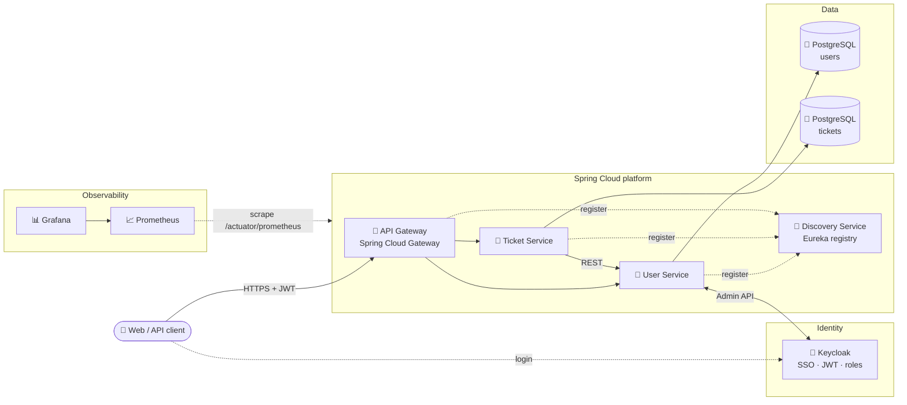
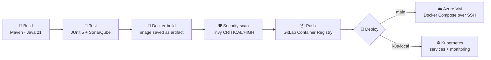
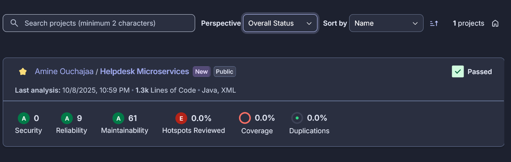
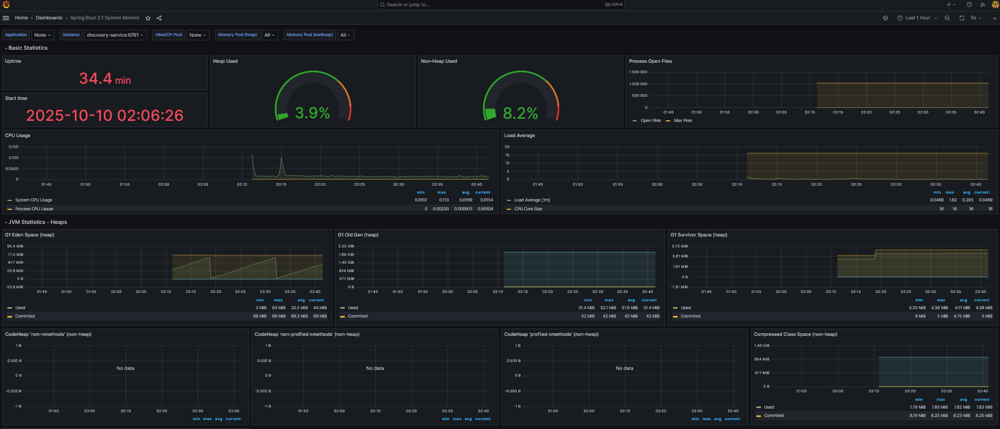
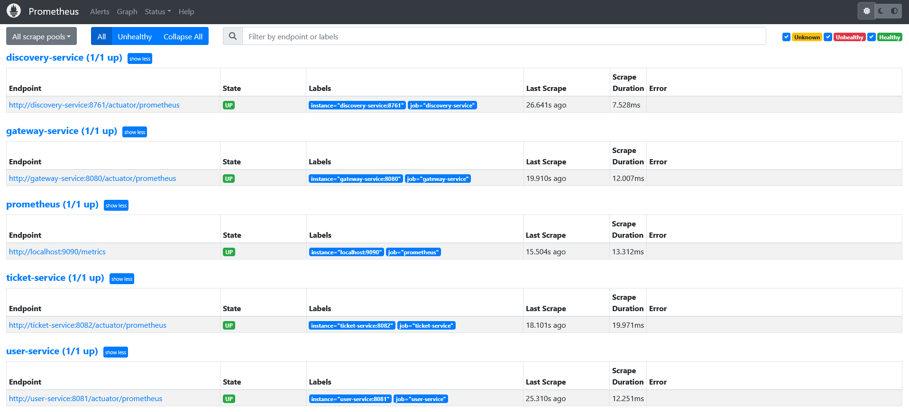

<div align="center">

# 🎫 HelpDesk — Cloud-Native IT Ticketing Platform

**Spring Boot microservices · Keycloak SSO · Kubernetes · Terraform on Azure · GitLab DevSecOps pipeline**

[](#-tech-stack)
[](#-tech-stack)
[](#-architecture)
[](#-security)
[](#-tech-stack)
<br/>
[](#-run-it-locally)
[](#-kubernetes)
[](#-infrastructure-as-code)
[](#-cicd-pipeline)
[](#-observability)
[](#-observability)

[Architecture](#-architecture) • [Features](#-features) • [CI/CD](#-cicd-pipeline) • [Screenshots](#-screenshots) • [Run it](#-run-it-locally) • [API](#-api-overview)

</div>

---

## 💡 What is it?

An internal **IT support platform**: employees open tickets, technicians handle them, admins manage users and follow service levels.

I built it end to end, from the code to production, to practise what a real team ships:

- 4 **Spring Boot microservices** behind an **API Gateway**, with **Eureka** service discovery;
- **Keycloak** single sign-on and role-based access control;
- a **GitLab CI/CD pipeline** that builds, tests, analyses with **SonarQube**, scans images with **Trivy**, then deploys;
- **Kubernetes** manifests, **Terraform** for the Azure infrastructure, and a **Prometheus + Grafana** monitoring stack.

<div align="center">

| 4 | 39 | 6 | 9 | Quality Gate |
|:---:|:---:|:---:|:---:|:---:|
| microservices | REST endpoints | pipeline stages | Kubernetes deployments | **Passed** on SonarQube |

</div>

---

## 🏗 Architecture



- **Database per service**: users and tickets live in two separate PostgreSQL instances.
- **Single entry point**: the gateway routes `/api/users/**`, `/api/admin/**` and `/api/tickets/**`, and aggregates the OpenAPI docs of every service.
- **Stateless security**: each service validates Keycloak JWTs as an OAuth2 resource server.

---

## ✨ Features

### 🎫 Ticket management
- Full lifecycle: `OPEN → IN_PROGRESS → PENDING → RESOLVED → CLOSED`
- 4 priorities (`LOW`, `MEDIUM`, `HIGH`, `URGENT`) and 6 categories (hardware, software, network, access, security, other)
- **Automatic SLA deadlines** based on priority, plus an **overdue** view:

  | Priority | SLA |
  |---|---|
  | 🔴 URGENT | 4 hours |
  | 🟠 HIGH | 24 hours |
  | 🟡 MEDIUM | 3 days |
  | 🟢 LOW | 7 days |

- Assignment to technicians, unassigned and open queues, full-text search
- **Audit trail**: every change on a ticket is recorded and can be replayed as a history
- **File attachments** with size and file-type validation
- Statistics endpoints for dashboards

### 👥 Users & access
- Self sign-up → **admin approval workflow** (`PENDING → ACTIVE`, or `REJECTED`)
- Accounts are provisioned and enabled in **Keycloak** through its Admin API
- 3 roles: `EMPLOYEE`, `TECHNICIAN`, `ADMIN`, enforced with Spring Security
- Admin tools: search, change role, deactivate, user statistics

---

## 🔄 CI/CD pipeline

Every push runs a **6-stage GitLab pipeline**, for each of the 4 microservices:



- Images are built **once**, scanned by **Trivy**, and only then pushed to the registry.
- Trivy reports are exported in **SARIF** format, ready for GitLab's security dashboard.
- Each service is analysed as its own module in **SonarQube**.
- Maven, Sonar and Trivy caches keep pipelines fast.

---

## ☸️ Kubernetes

The whole platform runs on Kubernetes (tested on Minikube): **9 deployments**, including both databases, Keycloak, the 4 microservices, Prometheus and Grafana.

The gateway, Keycloak, Eureka, Prometheus and Grafana are exposed through `NodePort` services:

| Service | URL |
|---|---|
| API Gateway | `http://<node-ip>:30080` |
| Keycloak admin | `http://<node-ip>:30180` |
| Eureka dashboard | `http://<node-ip>:30761` |
| Prometheus | `http://<node-ip>:30090` |
| Grafana | `http://<node-ip>:30300` |

---

## 🌍 Infrastructure as Code

`terraform/` provisions the **Azure** production environment from scratch:

- resource group, virtual network and subnet;
- network security group with only the required ports open;
- static public IP;
- Ubuntu VM (`Standard_B2s`) bootstrapped with Docker through cloud-init.

The pipeline then deploys `docker-compose.prod.yml` to this VM over SSH.

```bash
cd terraform
terraform init
terraform apply
```

---

## 📈 Observability

All services expose **Spring Boot Actuator** metrics in Prometheus format. **Grafana** dashboards show JVM memory, CPU, garbage collection and HTTP traffic for each service.

---

## 📸 Screenshots

<table>
<tr>
<td width="50%"><b>☸️ Kubernetes: 9 deployments, all running</b><br/></td>
<td width="50%"><b>✅ SonarQube: Quality Gate passed</b><br/></td>
</tr>
<tr>
<td width="50%"><b>📊 Grafana: JVM and system dashboard</b><br/></td>
<td width="50%"><b>📈 Prometheus: service targets</b><br/></td>
</tr>
<tr>
<td colspan="2"><b>🧭 Eureka: registered microservices</b><br/></td>
</tr>
<tr>
<td colspan="2"><b>🗺 End-to-end DevSecOps workflow</b><br/></td>
</tr>
</table>

---

## 🚀 Run it locally

**Prerequisites:** Docker and Docker Compose.

```bash
git clone https://github.com/ouchajaaamine/helpdesk.git
cd helpdesk
docker compose up -d
```

| Component | URL |
|---|---|
| API Gateway | http://localhost:8080 |
| Swagger UI, all services | http://localhost:8080/swagger-ui.html |
| Keycloak | http://localhost:8180 |
| Eureka | http://localhost:8761 |

The Keycloak realm (roles, client and test users) is imported from `keycloak-import/`. You can also create it with `./setup-keycloak-realm.sh`.

> The credentials in `docker-compose.yml` are local development defaults only. Never reuse them in a real environment.

---

## 📚 API overview

| Area | Endpoints (sample) |
|---|---|
| **Tickets** | `POST /api/tickets` · `GET /api/tickets/{id}` · `PUT /api/tickets/{id}/status` · `PUT /api/tickets/{id}/assign/{technicianId}` · `GET /api/tickets/overdue` · `GET /api/tickets/search` · `GET /api/tickets/{id}/history` |
| **Attachments** | `POST /api/tickets/{id}/attachments` · `GET …/attachments/{attachmentId}/download` |
| **Users** | `POST /api/users/signup` · `PUT /api/users/{id}/profile` · `PUT /api/users/{id}/password` |
| **Admin** | `GET /api/admin/pending-users` · `POST /api/admin/pending-users/{id}/approve` · `PUT /api/admin/users/{id}/role` · `GET /api/admin/stats` |

The full interactive documentation is generated with **springdoc-openapi** and aggregated by the gateway.

---

## 🧰 Tech stack

| Layer | Technologies |
|---|---|
| **Backend** | Java 21 (Java 17 for user-service), Spring Boot 3, Spring Cloud (Gateway, Eureka, LoadBalancer), Spring Data JPA, Spring Security |
| **Security** | Keycloak (SSO, JWT, Admin API), OAuth2 resource server, role-based access |
| **Data** | PostgreSQL 15, one database per service |
| **Testing** | JUnit 5, Spring Boot Test, Testcontainers |
| **Containers** | Docker, Docker Compose |
| **Orchestration** | Kubernetes (Minikube) |
| **Cloud & IaC** | Microsoft Azure, Terraform |
| **CI/CD** | GitLab CI/CD, GitLab Container Registry |
| **Quality & security** | SonarQube, Trivy |
| **Observability** | Spring Boot Actuator, Micrometer, Prometheus, Grafana |

---

## 📂 Project structure

```
helpdesk/
├── backend/
│   ├── discovery-service/   # Eureka registry
│   ├── gateway-service/     # Spring Cloud Gateway + aggregated Swagger
│   ├── user-service/        # Users, approval workflow, Keycloak provisioning
│   └── ticket-service/      # Tickets, SLA, audit trail, attachments
├── kubernetes/              # Deployments, services, Prometheus & Grafana
├── terraform/               # Azure infrastructure
├── keycloak-import/         # Keycloak realm (roles, clients)
├── docker-compose.yml       # Local environment
├── docker-compose.prod.yml  # Production environment (Azure VM)
└── .gitlab-ci.yml           # DevSecOps pipeline
```

---

## 🛣 Roadmap

- [ ] Web front-end (React) for employees and technicians
- [ ] Resilience4j circuit breakers between services
- [ ] Higher test coverage, enforced as a SonarQube quality gate
- [ ] Helm chart and deployment to a managed cluster (AKS)

---

<div align="center">

### 👋 Author

**Amine Ouchajaa**, Software Engineer (Java / Spring Boot · DevOps)

[](https://linkedin.com/in/amine-ouchajaa)
[](https://github.com/ouchajaaamine)

⭐ If you find this project useful, a star is always appreciated!

</div>
